# Branches & Orgs

## Branches & Orgs strategy

```mermaid
flowchart LR

    subgraph GitBranches [Git Branches]
        direction TB
        integrationBranch["integration"]:::gitMajor
        uatBranch["uat"]:::gitMajor
        hotfixBranch1["hotfix1"]:::gitFeature
        hotfixBranch2["hotfix2"]:::gitFeature
        preprodBranch["preprod"]:::gitMajor
        mainBranch["main"]:::gitMain
    end

    subgraph SalesforceOrgs [Salesforce Major Orgs]
        direction TB
        mainOrg(["<b>Production Org</b>"]):::salesforceProd
        preprodOrg(["<b>Preprod Org</b>"]):::salesforceMajor
        uatOrg(["<b>Uat Org</b>"]):::salesforceMajor
        integrationOrg(["<b>Integration Org</b>"]):::salesforceMajor
    end

    subgraph SalesforceDevOrgspreprod [Salesforce Dev Orgs]
        direction TB
        hotfix1Org(["Dev Hotfix1"]):::salesforceDev
        hotfix2Org(["Dev Hotfix2"]):::salesforceDev
    end

    hotfixBranch1 ==>|"Merge"| preprodBranch
    hotfixBranch2 ==>|"Merge"| preprodBranch
    integrationBranch ==>|"Merge"| uatBranch
    preprodBranch ==>|"Merge"| mainBranch
    uatBranch ==>|"Merge"| integrationBranch

    mainBranch -. Deploy to Org .-> mainOrg
    preprodBranch -. Deploy to Org .-> preprodOrg
    uatBranch -. Deploy to Org .-> uatOrg
    integrationBranch -. Deploy to Org .-> integrationOrg

    hotfix1Org <-. Push / Pull .-> hotfixBranch1
    hotfix2Org <-. Push / Pull .-> hotfixBranch2

    mainBranch ==>|"Retrofit from RUN to BUILD"| integrationBranch

    classDef salesforceDev fill:#9BC3FF,stroke:#2B65D9,stroke-width:2px,color:#000000,font-weight:bold,border-radius:10px;
    classDef salesforceMajor fill:#67B7D1,stroke:#004D66,stroke-width:2px,color:#FFFFFF,font-weight:bold,border-radius:10px;
    classDef salesforceProd fill:#4C98C3,stroke:#003B5A,stroke-width:2px,color:#FFFFFF,font-weight:bold,border-radius:10px;
    classDef gitMajor fill:#FFCA76,stroke:#E65C00,stroke-width:2px,color:#000000,font-weight:bold,border-radius:10px;
    classDef gitMain fill:#F97B8B,stroke:#CC2936,stroke-width:2px,color:#000000,font-weight:bold,border-radius:10px;
    classDef gitFeature fill:#B0DE87,stroke:#2D6A4F,stroke-width:2px,color:#000000,font-weight:bold,border-radius:10px;

    style GitBranches fill:#F4F5F9,color:#000000,stroke:#8B72B2,stroke-width:1px;
    style SalesforceOrgs fill:#F1F7F5,color:#000000,stroke:#468C70,stroke-width:1px;

style SalesforceDevOrgspreprod fill:#EBF6FF,color:#000000,stroke:#0077B5,stroke-width:1px;
linkStyle 0,1,2,3,4,11 stroke:#4B0082,stroke-width:4px,color:#4B0082,background-color:transparent;
linkStyle 5,6,7,8 stroke:#4169E1,stroke-width:2px,color:#4169E1,background-color:transparent;
linkStyle 9,10 stroke:#5F9EA0,stroke-width:2px,color:#5F9EA0,background-color:transparent;
```

| Git branch | Salesforce Org | Deployment Username |
| :--------- | :------------- | :------------------ |
| main | https://login.salesforce.com | helios-prod |
| preprod | https://login.salesforce.com | helios-preprod |
| uat | https://test.salesforce.com | helios-uat |
| integration | https://test.salesforce.com | helios-integration |

___

_Documentation generated from branch integration with [sfdx-hardis](https://sfdx-hardis.cloudity.com) by [Cloudity](https://cloudity.com?ref=sfdxhardis) command [`sf hardis:doc:project2markdown`](https://sfdx-hardis.cloudity.com/hardis/doc/project2markdown/)_

